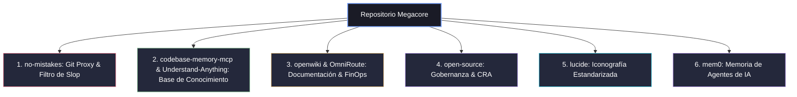

# 🌌 Megacore

> El estándar central de gobernanza, documentación, calidad de código y base de conocimiento común para todos los repositorios de Megasoft.

**Megacore** define los cimientos comunes y las herramientas transversales aplicadas a todos los proyectos de desarrollo en este entorno para asegurar que la interacción con agentes de Inteligencia Artificial (IA) y el flujo de desarrollo sigan estándares uniformes, limpios y eficientes.

## 🛠️ Los 6 Pilares de Megacore y su Ecosistema (2026)

El stack de **Megacore** se compone de seis pilares metodológicos, potenciados por utilidades clave de alto rendimiento ("Hype 2026") para la terminal y flujos de IA:



### 1. 🛡️ `no-mistakes` (Git Proxy & Calidad)
Evita la inserción de código defectuoso generado por IA ("AI slop") en las ramas principales. Intercepta los pushes (`git push no-mistakes`), levanta un entorno de trabajo aislado (*worktree* desechable) y ejecuta pipelines de validación (tests, linter, compilación) antes de propagar los cambios.
* **Fichero de configuración:** `.no-mistakes.yaml` en la raíz del proyecto.
* **Hype Tools de Apoyo:**
  * **`yazi`:** Utilizado para la navegación asíncrona rápida en terminal por los directorios temporales generados por el proxy.
  * **`bumblebee`:** Integrado para realizar auditorías automáticas de dependencias y MCPs antes de validar la subida del código.

### 2. 🧠 `codebase-memory-mcp` & `Understand-Anything` (Base de Conocimiento)
Indexa el código del repositorio en un grafo de conocimiento persistente. Permite a los agentes de IA comprender la arquitectura del proyecto, dependencias y flujos en milisegundos.
* **Herramienta Visual:** **Understand-Anything** mapea el código por dominios de negocio y genera un cuadro de mando local interactivo en el puerto `3030`.
* **Fichero de configuración:** `.understand-anything/config.json`
* **Comando de inicialización:** `/understand` en el agente de IA para compilar el grafo.

### 3. 📖 `openwiki` & `OmniRoute` (Documentación & FinOps)
Genera, estructura y mantiene la documentación técnica actualizada a partir del propio código fuente y las decisiones de diseño del repositorio de forma autónoma.
* **FinOps (Optimización):** Integrado con **OmniRoute** (local proxy en `localhost:20128`) para centralizar API keys, compilar llamadas con un 15-95% de ahorro de tokens y aplicar redirección automática de fallos (smart fallback) entre proveedores.
* **Comando de inicialización:** `openwiki --init` o `openwiki` para chat.

### 4. ⚖️ `open-source` (Gobernanza & Estándar)
Estructura y genera los elementos de gobernanza y control de seguridad alineados con la directiva europea CRA (Cyber Resilience Act).
* **Ficheros generados:** `LICENSE` (MIT), `CONTRIBUTING.md`, `SECURITY.md` (Español).
* **Escaneo automático:** El script `scripts/security_audit.sh` (basado en Perplexity Bumblebee) analiza el supply-chain del repo en busca de paquetes sospechosos en una sola pasada de sólo lectura.

### 5. 🎨 `lucide` (Iconografía Estandarizada)
Establece a **Lucide Icons** como la biblioteca unificada de iconos vectoriales SVG para todos los frontends del ecosistema. Reemplaza cualquier conjunto personalizado de iconos por una solución ligera, modular, mantenida por la comunidad y compatible con tree-shaking.
* **Integración rápida (HTML):**
  ```html
  <script src="https://unpkg.com/lucide@latest"></script>
  <i data-lucide="settings"></i>
  <script>lucide.createIcons();</script>
  ```
* **Integración en Frameworks:** Usar paquetes nativos como `lucide-react`, `lucide-vue-next` y `lucide-svelte`.

### 6. 🧠 `mem0` (Memoria Inteligente de Agentes de IA)
Implementa el estándar de memoria persistente y auto-correctiva a largo plazo para agentes autónomos. Reemplaza la infraestructura de base de datos de `hipocampo` por **Mem0**, que autogestiona la incorporación, actualización y depuración de recuerdos de forma híbrida (Vector + Graph + KV).
* **Fichero de configuración:** `mem0.yaml` en la raíz del proyecto.
* **Integración en Python:**
  ```python
  from mem0 import Memory
  memory = Memory.from_config("mem0.yaml")
  memory.add("El usuario prefiere respuestas en español", user_id="andres")
  ```

---

## 🚀 Cómo Aplicar Megacore a un Nuevo Repositorio

Para inicializar un repositorio con el estándar **Megacore**, sigue estos pasos:

### Paso 1: Configurar la Gobernanza y Seguridad (`open-source`)
1. Genera los archivos de políticas desde el agente conversacional ejecutando:
   ```bash
   /open-source
   ```
2. Realiza el primer escaneo de seguridad local para auditar dependencias y extensiones:
   ```bash
   ./scripts/security_audit.sh
   ```

### Paso 2: Inicializar el Grafo Visual (`Understand-Anything`)
1. Instala el plugin en tu agente de IA y genera el grafo:
   ```bash
   /understand
   ```
2. Lanza el dashboard para explorar visualmente el repositorio:
   ```bash
   /understand-dashboard
   ```

### Paso 3: Configurar la Validación Pre-push (`no-mistakes`)
1. Copia la configuración base:
   ```bash
   cp /home/asanchez/Code/forgejo/repositorios/megacore/.no-mistakes.yaml .
   ```
2. Empuja los cambios de forma segura a través del proxy:
   ```bash
   git push no-mistakes <rama>
   ```

### Paso 4: Inicializar la Wiki Técnica (`openwiki`)
Lanza la generación de documentación técnica:
```bash
openwiki --init
```

---

## 📁 Estructura del Repositorio

* `README.md` - Este documento de referencia general.
* `LICENSE` - Licencia MIT aplicable a los recursos del repositorio.
* `.no-mistakes.yaml` - Configuración base y por defecto del proxy git.
* `.understand-anything/config.json` - Configuración estándar de visualización de grafo.
* `scripts/security_audit.sh` - Script de escaneo de seguridad local (Bumblebee).
* `mem0.yaml` - Configuración estándar de memoria inteligente para agentes.
* `AGENTS.md` - Contexto, comandos y directivas operativas estandarizadas para agentes de IA de código.

---
*Megacore - Automatizando y estandarizando la calidad del software en Megasoft.*
